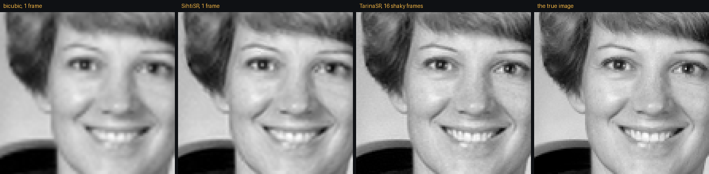
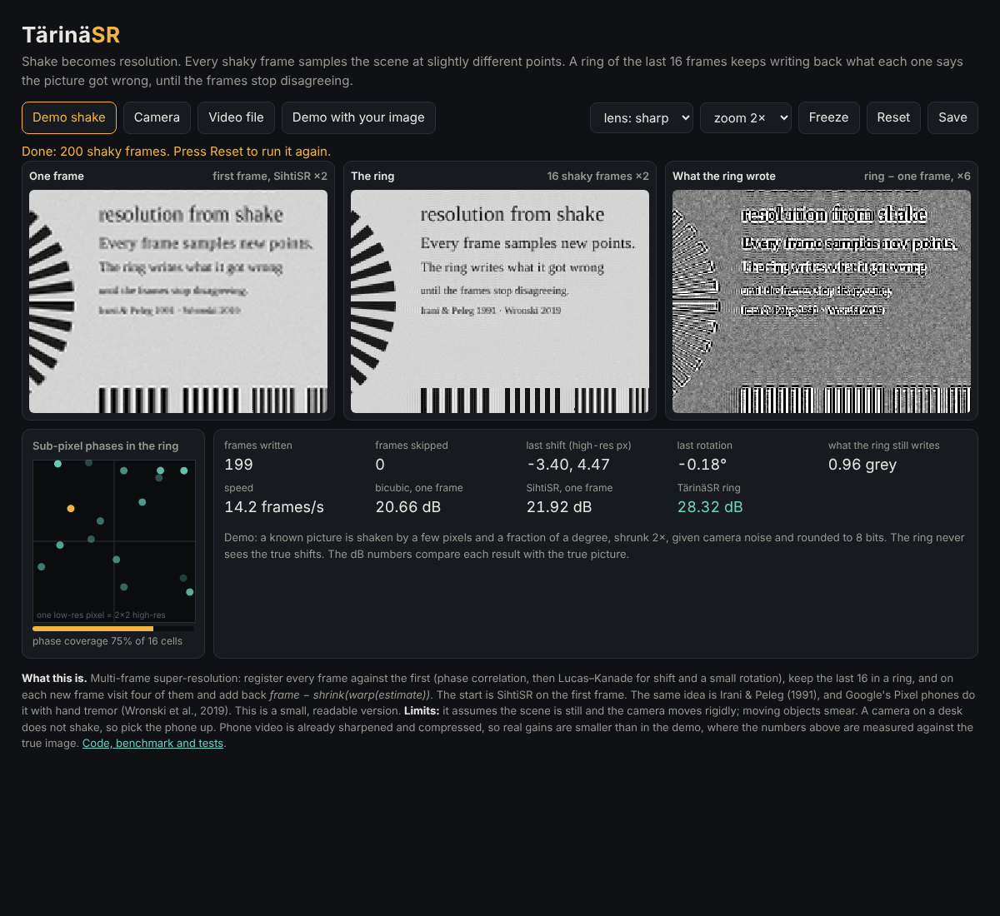

# TärinäSR: shake becomes resolution

EDIT: Added tarina_gui.py - python version of the web page by gemini argon. 

**[Try it](https://anttiluode.github.io/TarinaSR/)**: a demo with a known picture, your phone camera, or a handheld video file.



*Same crop, enlarged 3× without smoothing. Left to right: one frame with bicubic, one frame with SihtiSR, 16 shaky frames through the ring, and the true image.*

Every frame from a shaking camera samples the scene at slightly different points. One frame can't tell what lies between its pixels, but sixteen frames, each shifted by a different fraction of a pixel, together sample the gaps. TärinäSR keeps the last 16 frames in a ring. Each time a new frame arrives, it visits four of them and writes back what each frame says the picture still gets wrong:

```
r = frame − shrink(blur(warp(x, motion)))     what this frame says x got wrong
x = x + 0.4 · unwarp(blur(enlarge(r)), motion) write it back
```

When the frames stop disagreeing, the writing stops. The start is [SihtiSR](https://github.com/anttiluode/SihtiSR) on the first frame. Motion is found by phase correlation, then refined with Lucas–Kanade for shift plus a small rotation. Registration runs on blurred copies, so aliased fine detail doesn't pull it off. That one change cut the shift error on the test chart from 0.2 to 0.02 px.

It started as the day's joke turned around: in [GoldOpus](https://github.com/anttiluode/GoldOpus) and the other ring repos, ±1 tick of jitter broke every memory. In images, jitter is the information.

## Results

8 standard photos (scikit-image), ×2, grayscale, 16 frames. Each frame is the original shifted by up to ±6 px (high-res pixels), shrunk 2×, given camera noise and rounded to 8 bits. The ring never sees the true shifts. Mean PSNR ([`experiments/benchmark.py`](experiments/benchmark.py), [`results/benchmark.json`](results/benchmark.json)):

| method | PSNR (dB) |
|---|---|
| bicubic, one frame | 30.90 |
| SihtiSR, one frame | 31.86 |
| TärinäSR, 2 frames | 32.57 |
| 4 frames | 34.14 |
| 8 frames | 36.01 |
| **16 frames** | **37.42** |

**+5.6 dB over SihtiSR alone, +6.5 dB over bicubic.** Mean registration error is 0.02 high-res px.

**Controls: where the gain comes from**

| condition | PSNR (dB) |
|---|---|
| the same 16 frames registered and **averaged**, then SihtiSR | 31.64 |
| 16 frames shifted by **whole pixels only**, through the ring | 32.05 |

Averaging gives nothing: the gain isn't noise reduction. Whole-pixel shake gives nothing either: every frame then samples the same points. All of the gain comes from sub-pixel phases, the ones the page's phase square shows filling in.

**Stress**

| condition | PSNR (dB) |
|---|---|
| plus rotation up to ±0.3° | 37.24 |
| plus rotation up to ±1° | 37.19 |
| shake up to ±40 px | 36.82 |

**Closer to a real camera** ([`experiments/realistic.py`](experiments/realistic.py)): a lens blur (Gaussian σ 0.7 high-res px) before the pixels, rotation up to ±0.5°, and JPEG quality 85. Truth is the sharp original.

| method | PSNR (dB) |
|---|---|
| bicubic, one frame | 29.33 |
| SihtiSR, one frame | 29.99 |
| TärinäSR, ring told nothing about the lens | 30.83 |
| ring told lens 0.5 (too little) | 31.53 |
| **ring told lens 0.7 (right)** | **32.06** |
| ring told lens 0.9 (too much) | 31.63 |

With a blurry lens and compression, the gain falls from +5.6 to **+2.1 dB** over SihtiSR. It still holds when the lens guess is wrong in either direction. The page has a lens selector; camera and video modes start at 0.7.

## The page

- **Demo shake.** A test chart (or your own image) is shaken, shrunk and noised. The three dB numbers are measured against the true picture, live. In headless Chromium after 200 frames: bicubic 20.66, SihtiSR 21.92, ring 28.32 dB. The chart has sharper detail than photos, so the absolute numbers are lower.
- **Camera.** Uses the camera's own pixels from a 240×180 centre crop, never rescaled: rescaling would remove the aliasing that carries the extra information. Hold the phone in your hand and point it at small text. A phone resting on a table doesn't shake, so it gets nothing.
- **Video file.** A handheld clip of a still scene.
- **Phase square:** where each ring frame's sampling grid falls inside one low-res pixel. **What the ring wrote:** ring minus the one-frame start, ×6.

About 10–15 frames per second on a laptop.



## What this is, plainly

- **It isn't new.** Multi-frame super-resolution by iterative back-projection is Irani & Peleg (1991). Google's Pixel phones use natural hand tremor for exactly this ([Wronski et al., SIGGRAPH 2019](https://arxiv.org/abs/1905.03277)). Phase correlation and Lucas–Kanade are textbook. This is a small, readable version (about 200 lines of core in each language), with the controls that show where the gain comes from.
- **The demo is kind to it.** Demo frames are made with the same warp the ring uses. The Python benchmark uses scipy's shift and rotate instead, so the ring's own model isn't the one that made the data there.
- **Limits:**
  - The scene must be still and the camera motion rigid: shift plus small rotation, no perspective. Moving objects smear.
  - Zoom is fixed at ×2.
  - Phone video is already sharpened, denoised and compressed. Real gains will be closer to the "real camera" table than the clean one, and may be smaller. That hasn't been measured on real phone footage yet.
- **Not used:** deep learning, training (beyond SihtiSR's 21,600 solved numbers for the start), or any outside service. Everything runs in the browser tab.

## Run

```sh
pip install -r requirements.txt
python -m unittest discover -s tests -v      # 7 tests, includes JS == Python (needs node)
python experiments/benchmark.py              # the tables above, ~15 min on 1 CPU
python experiments/realistic.py
python experiments/figure.py                 # results/crops.png
```

Open `index.html` from disk, or via GitHub Pages. No server, no libraries.

Files: [`tarina.py`](tarina.py) and [`tarina.js`](tarina.js) are the same algorithm (the test checks motions agree to 1e-14 and pixels to 1e-6). [`app.js`](app.js) is the page. `sihtisr.py`, `sihti.js` and `model.*` are copied unchanged from [SihtiSR](https://github.com/anttiluode/SihtiSR).

## Lineage

[Sihti](https://github.com/anttiluode/Sihti) → [SihtiSR](https://github.com/anttiluode/SihtiSR) (one frame), plus the ring and the shared phase from [GoldOpus](https://github.com/anttiluode/GoldOpus) and [PhaseLockedPredictiveCoding](https://github.com/anttiluode/PhaseLockedPredictiveCoding) → TärinäSR. Built by Opus 5.5 for Antti Luode. MIT.
